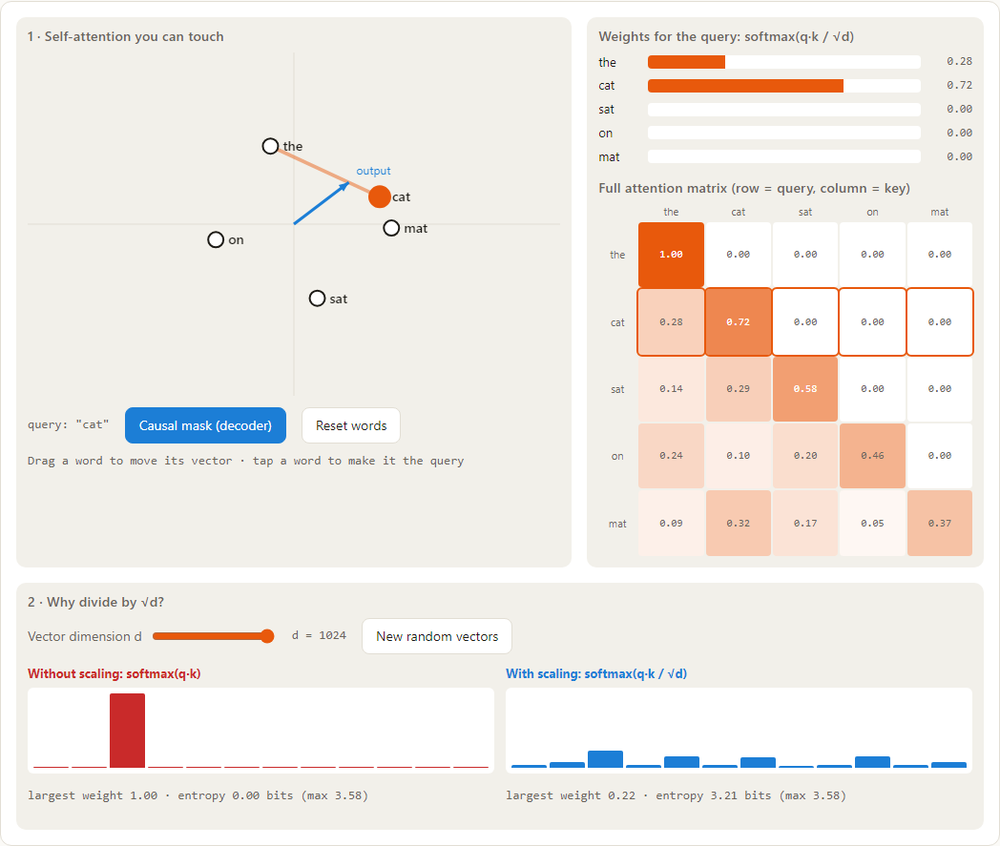

# 🧪 Paper → Playground

**Landmark AI and robotics papers, each turned into a small interactive demo you can play with in your browser.**
Don't just read about attention, diffusion or PPO: drag, poke and watch the core idea respond.

### ▶ [Open the gallery](https://zerochance1907.github.io/paper-playground/)



[](https://github.com/zerochance1907/paper-playground/actions/workflows/ci.yml)
[](LICENSE)

## What's inside

Every demo:

- **does real computation** in the browser: attention scores, gradient descent,
  diffusion steps, ray marching, run live in plain JavaScript;
- has a **60-second plain-English explainer** and a **"Try this"** list;
- states **exactly how it simplifies the paper**, so a toy is never passed off as the
  paper's real result;
- is **tested in a real browser** before it's published: it must respond to input,
  log no errors, work on a phone, and load only pinned, allow-listed scripts.

## Request any paper

Open a [**paper request**](https://github.com/zerochance1907/paper-playground/issues/new?template=add-paper.yml)
with an arXiv link. When a maintainer labels it `build-paper`, a Claude Code agent:

1. pulls the paper's metadata from arXiv (`scripts/new-paper.mjs`),
2. reads the paper and picks the one idea worth understanding,
3. builds the demo following [`CLAUDE.md`](CLAUDE.md), the spec every demo must meet,
4. runs `scripts/check.mjs` in headless Chromium until it passes, and
5. opens a pull request for human review.

## Generate a demo yourself, free

You don't need Claude or any API key. One command turns any arXiv paper into a working demo page:

```bash
npm run generate -- 1312.5602            # or an arXiv URL
```

It picks one of five hand-written, browser-tested **demo engines**, fills in the paper's
title, explanation, tags and settings, writes `papers/<slug>/`, and runs the browser
checker:

| Engine | What runs live in the browser | Good for |
|---|---|---|
| `optimizer` | SGD, momentum, Nesterov, AdaGrad, RMSProp and Adam racing on 2D loss surfaces | optimizers, training dynamics |
| `classifier` | two small neural nets trained side by side, identical except for one change (dropout, weight decay, residual connections, depth, ReLU) | architectures, regularisation |
| `generative` | a 2D diffusion sampler denoising noise into a shape you can draw | diffusion, GANs, VAEs, flows |
| `rl` | Q-learning, SARSA or REINFORCE in an editable cliff gridworld | RL, policy gradients, control |
| `sequence` | a character language model with adjustable context length | language models, transformers, RNNs |

**Text backends**: the model, if any, writes only about 600 tokens of JSON text and never code,
so a weak model can't break a page.

| `--backend` | Cost | What writes the text |
|---|---|---|
| `template` | $0, instant | no AI: keyword rules choose the engine, and the explainer quotes the abstract |
| `ollama` (the default `auto` uses it when Ollama is running) | $0, local | any local model, e.g. `ollama pull qwen3:8b` (≈1.5K tokens per paper) |
| `openai` | free–cents | any OpenAI-compatible server: LM Studio, llama.cpp, OpenRouter, Groq… (`OPENAI_BASE_URL`, `OPENAI_API_KEY`, `OPENAI_MODEL`) |
| `anthropic` | ≈ $0.005 | Claude Haiku (`ANTHROPIC_API_KEY`) |

Useful flags: `--kind <engine>` to override the engine choice, `--slug`, `--force`,
`--dry-run` (print without writing). From GitHub, a maintainer can add the `generate-free`
label to a paper request (or run the workflow from the Actions tab). The free generator then
opens a pull request with no secrets needed.

Generated pages are general illustrations of a paper's idea. The hand-built demos in the
gallery are made with Claude Code following [`CLAUDE.md`](CLAUDE.md) and are specific to each paper.

## How it works

```
papers/<slug>/paper.json   metadata + the interactions the checker performs
papers/<slug>/index.html   the demo: one file, shared header/theme from papers/_shared/
papers/<slug>/thumb.png    gallery card, captured by the checker after interacting
scripts/new-paper.mjs      arXiv id → paper.json
scripts/check.mjs          Playwright: structure, console errors, pinned CDNs, size,
                           phone overflow, and "did the demo visibly respond?"
scripts/build.mjs          gallery + papers → dist/ (deployed to GitHub Pages)
scripts/generate.mjs       arXiv id → complete demo page, free (generator/kinds/ = demo engines)
```

## Run locally

```bash
npm install && npx playwright install chromium
npm run check          # test every demo in a real browser
npm run build          # build dist/
npx serve dist         # or: python -m http.server --directory dist
```

## Add a paper by hand

```bash
node scripts/new-paper.mjs https://arxiv.org/abs/1706.03762
# write papers/<slug>/index.html following CLAUDE.md
node scripts/check.mjs <slug>
```

## License

Code and demos: [MIT](LICENSE). Papers belong to their authors; each demo links to
the original.
